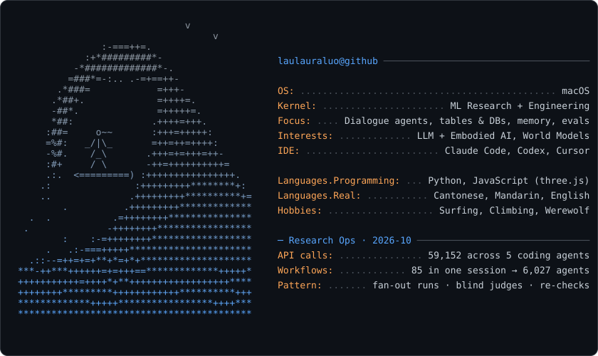

<picture>
  <source media="(prefers-color-scheme: dark)" srcset="dark_mode.svg">
  <source media="(prefers-color-scheme: light)" srcset="light_mode.svg">
  
</picture>

## Open source

[AI Code Review Triage](https://github.com/laulauraluo/ai-code-review-triage) — a Claude Code skill for reviewing AI-written PRs: reproduce bugs, check context beyond the diff, and state what was verified before approval. Includes illustrative walkthroughs; MIT licensed.
