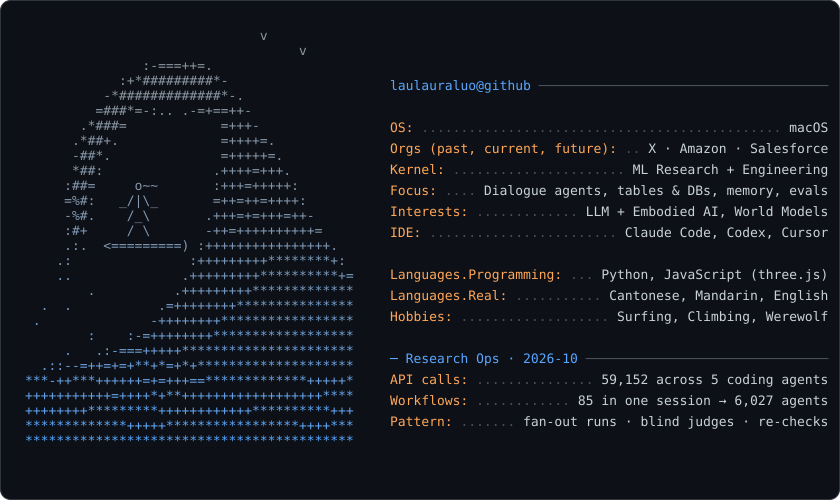

<picture>
  <source media="(prefers-color-scheme: dark)" srcset="dark_mode.svg">
  <source media="(prefers-color-scheme: light)" srcset="light_mode.svg">
  
</picture>

## Open source

[AI Code Review Triage](https://github.com/laulauraluo/ai-code-review-triage) — a Claude Code skill for reviewing PRs written by AI coding agents (Claude Code, Codex, Copilot, Cursor): reproduce bugs, check context beyond the diff, and state what was verified before approval. Includes illustrative walkthroughs; MIT licensed.

[Pixel Progress Tracker](https://github.com/laulauraluo/pixel-progress-tracker) — six themed progress trackers for any task (five in pixel art), bilingual zh/en. Any AI assistant, Claude Code or Codex included, can adapt one to your task from about 1.6k tokens of input. [Live demo](https://laulauraluo.github.io/pixel-progress-tracker/).
